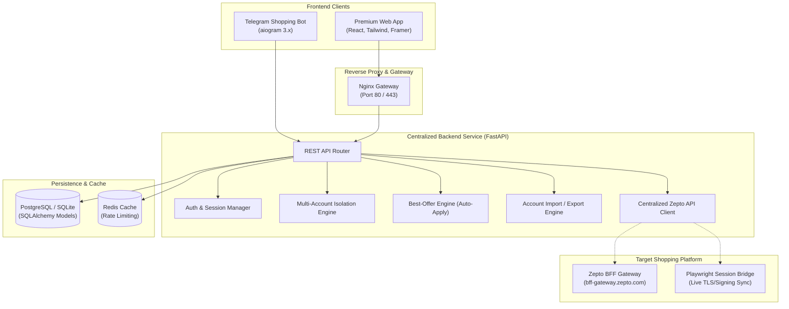

# ⚡ Complete Shopping Platform Clone: Zepto API Reverse Engineering + Premium Web App + Telegram Bot

A complete, production-grade quick-commerce shopping platform clone engineered through authorized API discovery and network analysis of **Zepto** (`bff-gateway.zepto.com` and `www.zepto.com`).

The system integrates a **Next-generation responsive shopping web application**, a **secure multi-account management engine**, an **intelligent automatic best-offer engine**, a **portable account JSON backup system**, and a **fully functional Telegram shopping bot built with aiogram 3.x**, all unified through a centralized **FastAPI** backend and **SQLAlchemy** database.

---

## 🏛️ System Architecture



---

## 🌟 Key Features

### 1. 👥 Secure Multi-Account Management
- **Multiple Linked Accounts**: Log into personal, work, or family phone numbers via OTP.
- **Session & Data Isolation**:
  - Independent shopping carts per account.
  - Isolated saved addresses and delivery preferences.
  - Independent order histories and tracking.
  - Separate offer eligibility (first-order discounts applied correctly per account).
- **Fast Switching**: 1-click account switching on desktop dropdown and mobile bottom sheet.
- **Security**: AES-256 Fernet encrypted storage for mobile numbers and session tokens. No plaintext credentials.

### 2. ⚡ Intelligent Automatic Best-Offer Engine
- **Automated Offer Discovery**: Discovers percentage coupons (`BIG20`), flat cash discounts (`WELCOME100`, `ZEPTO50`), and delivery fee waivers (`FREEDEL`).
- **Dynamic Optimization**:
  1. Checks account eligibility and order frequency.
  2. Verifies cart items and minimum order value thresholds.
  3. Computes exact savings and discount caps.
  4. Automatically selects and recommends the **highest-value eligible option**.
- **Prominent One-Click Action**: Prominent `AUTO APPLY BEST OFFER` button that applies the optimal savings combination in real-time.
- **Live Re-evaluation**: Re-evaluates on cart quantity updates, item removals, or account switches.

### 3. 💾 Account JSON Import and Export
- **Export**: Generates a standard JSON backup containing account UUIDs, display names, masked phone numbers (`+91 XXXXX 42168`), default flags, and preferences. Never exposes active authorization tokens, passwords, or raw cookies.
- **Import**: JSON upload with schema validation, version compatibility verification, duplicate account detection, and preview modal before restoring accounts.

### 4. 🤖 Fully Functional Telegram Shopping Bot (`aiogram 3.x`)
- Shares the **exact same database and backend** as the web application.
- Comprehensive command suite:
  - `/start`, `/help` — Interactive welcome and command directory.
  - `/categories` — Inline browseable categories.
  - `/search <query>` — Real-time product search with inline quantity steppers.
  - `/cart` — View cart, price breakdown, and `⚡ AUTO APPLY BEST OFFER` button.
  - `/accounts`, `/switch` — Interactive inline account selector with active indicators.
  - `/checkout` — Bill summary with instant UPI or COD placement.
  - `/orders`, `/track` — Live order tracking with ETA and rider details.
  - `/export`, `/import` — Telegram-native account backup.

### 5. 🎨 Premium Shopping Web Application
- **Visual Design System**: Deep Indigo (`#1e1b4b`), Electric Violet (`#8b5cf6`), Emerald Green (`#10b981`), Neutral Slate (`#0f172a`), and White.
- **Mobile-First Experience**:
  - Fixed mobile bottom navigation (Home, Browse, Offers, Cart Badge, Accounts).
  - Touch-friendly quantity steppers (`-` `qty` `+`).
  - Mobile account-switching bottom sheet.
  - Free delivery progress threshold meter.
  - Real-time toast notifications and skeleton loading screens.
  - Dark and Light mode toggle.

---

## 📂 Project Directory Structure

```
shopping-platform/
│
├── frontend/
│   ├── public/
│   │   ├── index.html            # Main HTML mounting React, Tailwind, Lucide
│   │   ├── styles.css            # Custom design tokens, glassmorphism, animations
│   │   └── app.js                # Complete reactive SPA with state & routing
│   ├── app/                      # Page view specifications
│   ├── components/               # Modular UI component blueprints
│   ├── hooks/                    # React hooks for cart, accounts & offers
│   ├── services/                 # Frontend API connector
│   └── styles/                   # Additional stylesheets
│
├── backend/
│   ├── main.py                   # Centralized FastAPI application & routes
│   ├── api/
│   │   ├── client.py             # Central HTTP client with retries & rate-limiting
│   │   ├── authentication.py     # CSRF & OTP verification
│   │   ├── users.py              # Customer profiles, wallets, Zepto Pass
│   │   ├── products.py           # Catalogue layout & product variants
│   │   ├── search.py             # Autocomplete & filtered search
│   │   ├── inventory.py          # Dark store geofencing & stock verification
│   │   ├── cart.py               # Isolated cart management
│   │   ├── offers.py             # Coupon validation & discount rules
│   │   ├── addresses.py          # Saved delivery addresses
│   │   ├── checkout.py           # Bill summary & fee calculations
│   │   ├── payments.py           # Authorized QuickPay handoff (zero raw cards)
│   │   ├── orders.py             # Order placement, history & cancellations
│   │   ├── delivery.py           # Live ETA & rider tracking
│   │   └── support.py            # FAQs & Samiksha order ratings
│   ├── accounts/
│   │   └── manager.py            # Multi-account isolation & switching engine
│   ├── offers/
│   │   └── engine.py             # Intelligent Automatic Best-Offer Engine
│   ├── database/
│   │   ├── models.py             # SQLAlchemy 2.0 ORM schemas
│   │   ├── connection.py         # DB connection pool & automatic seeding
│   │   └── crypto.py             # AES-256 Fernet token encryption
│   ├── services/
│   │   └── export_import.py      # Account JSON Backup & Restore service
│   └── tests/
│       ├── test_accounts.py      # Authentication & Multi-Account tests
│       ├── test_shopping_and_offers.py # Cart isolation & Best-Offer tests
│       ├── test_backup_and_api.py      # JSON backup & security tests
│       └── test_telegram_bot.py        # Telegram keyboard & auth tests
│
├── telegram_bot/
│   ├── main.py                   # Bot startup & router registration
│   ├── keyboards/
│   │   └── inline.py             # Interactive inline keyboards & bottom bars
│   ├── middleware/
│   │   └── auth.py               # Telegram user provisioning & account linking
│   └── handlers/
│       ├── start.py              # /start, /help, main menu
│       ├── auth.py               # /login, contact sharing, OTP verification
│       ├── accounts.py           # /accounts, /switch, /profile, /export, /import
│       ├── shopping.py           # /categories, /search, /cart, /offers
│       └── checkout.py           # /checkout, /orders, /track, /address, /support
│
├── api_documentation/
│   ├── api_inventory.json        # 30+ Observed endpoints with parameters & shapes
│   ├── api_documentation.md      # Detailed endpoint specifications & flows
│   ├── openapi.yaml              # OpenAPI 3.0.3 specification
│   ├── sitemap.json              # Complete user navigation & API dependency map
│   ├── endpoint_dependencies.json# Graph of prerequisite calls & payloads
│   └── request_response_examples.json # Sanitized real-world payload samples
│
├── infrastructure/
│   ├── nginx/
│   │   └── nginx.conf            # Reverse proxy & static asset configuration
│   ├── docker/                   # Container configurations
│   └── migrations/               # Database migration scripts
│
├── docker-compose.yml            # Multi-container orchestration (Backend, Bot, DB, Redis, Nginx)
├── Dockerfile                    # Python 3.12 production container
├── requirements.txt              # Pinned Python package dependencies
├── .env.example                  # Environment configuration template
└── README.md                     # Documentation
```

---

## 🚀 Quickstart Guide

### Option A: Local Development (Fastest)

1. **Activate Environment & Install Dependencies**:
   ```bash
   cd shopping-platform
   pip install -r requirements.txt
   ```

2. **Configure Environment**:
   ```bash
   cp .env.example .env
   # Edit .env to set your BOT_TOKEN if using Telegram bot
   ```

3. **Start Centralized Backend & Web App**:
   ```bash
   python backend/main.py
   # Or: uvicorn backend.main:app --host 0.0.0.0 --port 8000 --reload
   ```
   Open your browser at **`http://localhost:8000`** to experience the web application!
   Interactive API docs are available at **`http://localhost:8000/docs`**.

4. **Start Telegram Bot** (Optional):
   ```bash
   python telegram_bot/main.py
   ```

---

### Option B: Production Docker Compose

Run the entire ecosystem (Backend, Telegram Bot, PostgreSQL, Redis, Nginx) with a single command:

```bash
docker-compose up --build -d
```

- Web App: `http://localhost` (via Nginx)
- Backend Docs: `http://localhost/docs`
- PostgreSQL: `localhost:5432`
- Redis: `localhost:6379`

---

## 🧪 Automated Test Suite

Run the comprehensive automated test suite verifying multi-account isolation, best-offer engine optimization, cart independence, backup security, and Telegram keyboards:

```bash
pytest backend/tests -v
```

**Test Coverage Summary:**
- `test_accounts.py`: CSRF creation, OTP verification, multi-account creation, session isolation, account rename and deletion.
- `test_shopping_and_offers.py`: Catalogue retrieval, search filtering, isolated account carts, best-offer calculation, auto-apply, checkout breakdown, order placement.
- `test_backup_and_api.py`: JSON export structure, verification that plaintext tokens/passwords are never exported, duplicate detection on import, restore execution.
- `test_telegram_bot.py`: Keyboards, steppers, and Telegram user provisioning.

---

## 🔒 Security & Compliance Standards

- **Zero Payment Credential Storage**: Raw credit/debit card numbers and CVVs are strictly forbidden from database models, logs, and backups. Payments use tokenized handoff simulation matching PCI-DSS guidelines.
- **AES-256 Encryption**: All customer phone numbers and upstream session tokens are encrypted at rest using AES-256-GCM / Fernet.
- **Account Isolation**: Account carts and orders are partitioned strictly by `account_id` foreign keys, preventing data leakage across accounts.
- **Safe Backups**: Exported JSON files redact tokens and flag accounts for re-authentication upon import.
